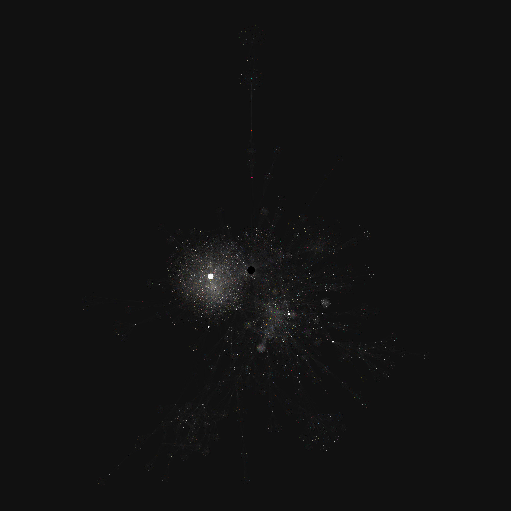
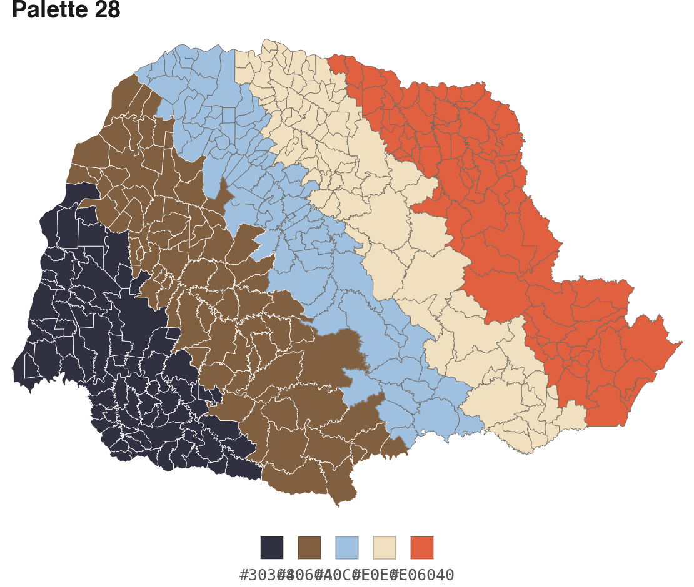
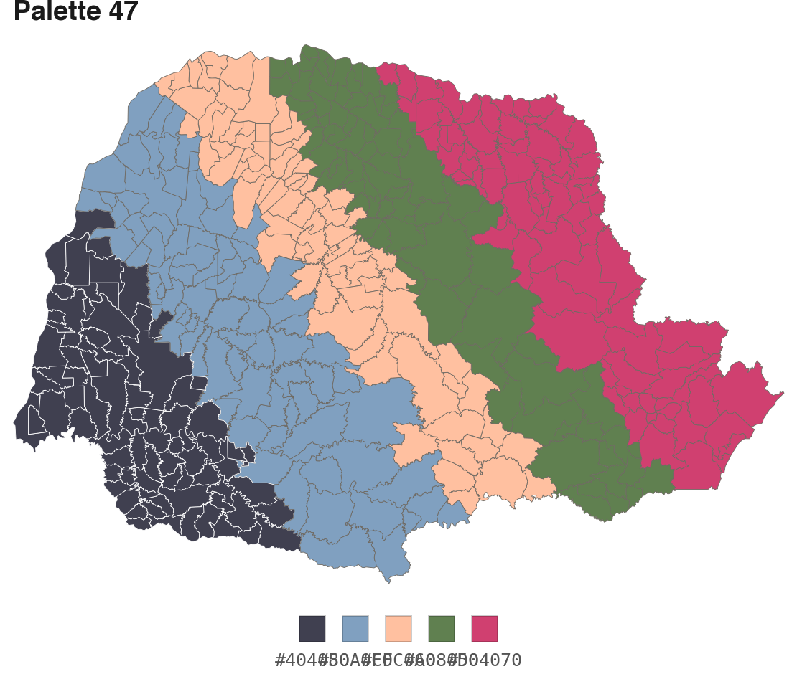
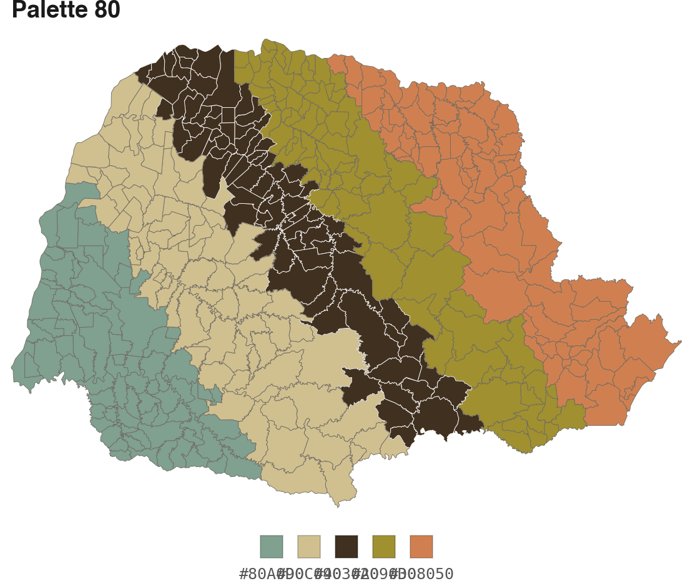

# Color co-occurrence network

Palettes connect colors. And different palettes can share colors. Therefore, colors that connect different palettes grow a network. What does that network look like?



A network of colors built from the [pypalettes](https://github.com/JosephBARBIERDARNAL/pypalettes) dataset: two colors are linked when they appear together in the same palette. Each node is drawn in its own color and sized by its centrality.

What if I use the network structure to infer new color palettes? Will those combinations look aesthetically pleasing?It looks like this:

<p align="center">
  
  
  
</p>

## Project layout

```
.
├── README.md                            this file
├── .gitignore                           ignores __pycache__/ and *.pyc
├── data/                                input data
│   ├── palettes.json                    list of palettes; each a sorted, deduped
│   │                                    list of hex colors (generated by data.py)
│   └── parana_municipalities.geojson    Paraná's 399 municipalities (for viz_parana.py)
├── review/                              interactive selection pages (generated by build_review_pages.py)
│   ├── palette_review.html              like/dislike the 100 predicted palettes
│   └── palette_final.html               pick 10 palettes from the common ones
├── plots/                               rendered figures and maps (generated)
│   ├── color_network.png                the full co-occurrence network
│   ├── color_network_zoom.png           a zoomed central crop of the network
│   ├── kcore.png                        the k-core of the network
│   ├── stats_degree.png                 top colors by degree
│   ├── stats_betweenness.png            top colors by betweenness
│   ├── stats_degree_vs_betweenness.png  betweenness vs degree scatter
│   ├── new_palettes/                    discovered 5-color palettes, 5 per image, indexed
│   └── maps/                            palette choropleth pages + images + print PDF
│       ├── palette_viz.html             an earlier choropleth (no generator, kept as-is)
│       ├── palette_viz_parana.html      Paraná's 399 municipalities (generated by viz_parana.py)
│       ├── palette_28.png / _47 / _80   the 3 selected palettes on Paraná (generated by render_maps.py)
│       └── palettes.pdf                 print version (maps + zoomed network), from build_palette_pdf.py
├── results/                             generated data
│   ├── new_palettes.json                discovered palettes: index, colors, seed edge, score
│   ├── selected_palettes_*.json         liked palettes, one file per review pass
│   ├── common_palettes.json             palettes liked in common across all passes
│   └── final_palettes.json              the 10 chosen on /final (written by review_server)
└── scripts/                             code, grouped by goal
    ├── shared/
    │   └── graph.py                     shared module: build / analyze / render the graph
    ├── ingest/
    │   └── data.py                      fetch pypalettes -> data/palettes.json
    ├── network/
    │   ├── network.py                   build + render the full network
    │   ├── network_zoom.py              render a zoomed central crop of the network
    │   └── kcore.py                     build + render the k-core
    ├── stats/
    │   └── stats.py                     degree / betweenness statistics plots
    └── palette/
        ├── palette.py                   discover new 5-color palettes
        ├── build_review_pages.py        generate review/*.html from the results JSON
        ├── review_server.py             serve the review pages + save liked palettes
        ├── common_palettes.py           palettes liked in common across review passes
        ├── viz_parana.py                the final palettes on a Paraná choropleth
        ├── render_maps.py               the 3 palettes as standalone PNG maps
        └── build_palette_pdf.py         plots/maps/palettes.pdf from a viz page + the network image
```

## Scripts

- **`scripts/shared/graph.py`** — the shared module imported by every other script. Holds the graph helpers (`load_palettes`, `build_graph`, `quantize_color`, `giant_component`, `to_graph_tool`, `vertex_rgba`, `centrality`, `betweenness_dict`, `layout`, `draw`) and the canonical `data/`, `plots/`, `results/` paths.
- **`scripts/ingest/data.py`** — reads the `pypalettes` package and writes `data/palettes.json`: each palette normalized to sorted, deduped, uppercase hex (alpha byte dropped) and filtered to 2–50 colors.
- **`scripts/network/network.py`** — builds the co-occurrence graph (edge = two colors share a palette), keeps the giant component, and renders it to `plots/color_network.png`.
- **`scripts/network/network_zoom.py`** — re-lays out the same graph (same seed, so the layout matches `color_network.png`), renders it larger and crops the central square, so it reads as a camera zoom into the network's core; writes `plots/color_network_zoom.png`.
- **`scripts/network/kcore.py`** — extracts the k-core (every node with degree ≥ 30) and renders it to `plots/kcore.png`.
- **`scripts/stats/stats.py`** — ranks colors by degree and betweenness centrality and writes three plots: `plots/stats_degree.png`, `plots/stats_betweenness.png`, `plots/stats_degree_vs_betweenness.png`.
- **`scripts/palette/palette.py`** — predicts missing edges and completes near-cliques to find palettes that don't yet exist; writes `plots/new_palettes/*.png` (5 indexed palettes per image) and `results/new_palettes.json`.
- **`scripts/palette/build_review_pages.py`** — generates the two review pages (`review/palette_review.html`, `review/palette_final.html`) by re-deriving their embedded `PALETTES` data from `results/new_palettes.json` and `results/common_palettes.json`.
- **`scripts/palette/review_server.py`** — serves the two review pages (`review/palette_review.html` to like/dislike the 100 predicted palettes, `review/palette_final.html` to pick 10 of the common ones) and saves the liked palettes to `results/selected_palettes_{i}.json` (auto-incremented, one file per pass) and the final 10 to `results/final_palettes.json`.
- **`scripts/palette/common_palettes.py`** — intersects the `results/selected_palettes_*.json` files to find the palettes chosen in common (in every file by default); writes `results/common_palettes.json`.
- **`scripts/palette/viz_parana.py`** — renders the 3 final palettes on a choropleth of Paraná's 399 municipalities, binning them into 5 bands along a tilted axis so every palette color is used equally; writes `plots/maps/palette_viz_parana.html`.
- **`scripts/palette/render_maps.py`** — renders each of the 3 palettes as a standalone PNG map (map + legend) for the README; writes `plots/maps/palette_28.png`, `palette_47.png`, `palette_80.png`.
- **`scripts/palette/build_palette_pdf.py`** — builds `plots/maps/palettes.pdf` — one page per final palette (its choropleth as vector SVG) plus a dark page with the zoomed network — using a headless Chrome/Chromium on PATH.

## Usage

```bash
python scripts/ingest/data.py            # pypalettes -> data/palettes.json
python scripts/network/network.py        # -> plots/color_network.png
python scripts/network/network_zoom.py   # -> plots/color_network_zoom.png
python scripts/network/kcore.py          # -> plots/kcore.png
python scripts/stats/stats.py            # -> plots/stats_*.png
python scripts/palette/palette.py        # -> plots/new_palettes/*.png + results/new_palettes.json
python scripts/palette/review_server.py  # serve the review pages at http://localhost:8000
python scripts/palette/common_palettes.py  # -> results/common_palettes.json
python scripts/palette/build_review_pages.py  # -> review/palette_review.html + review/palette_final.html
python scripts/palette/viz_parana.py     # -> plots/maps/palette_viz_parana.html
python scripts/palette/render_maps.py    # -> plots/maps/palette_{28,47,80}.png
python scripts/palette/build_palette_pdf.py  # -> plots/maps/palettes.pdf (needs headless Chrome)
```
